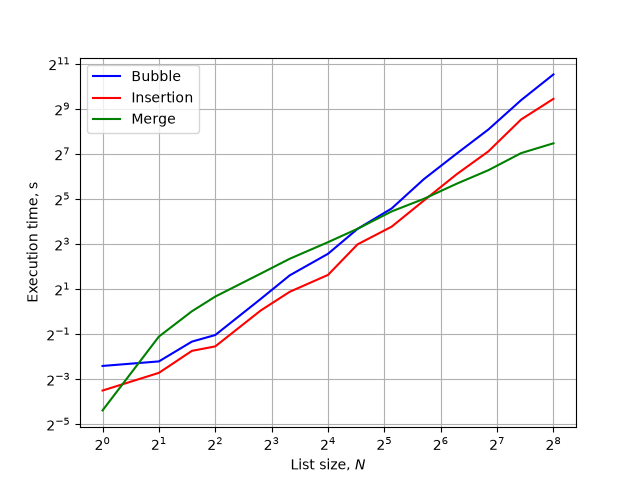
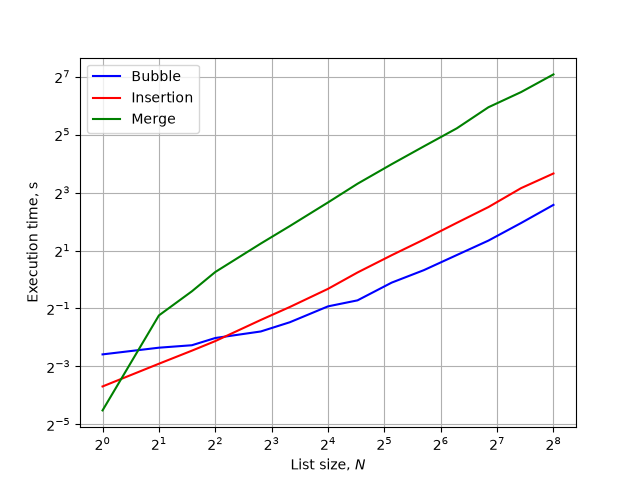

# Solution

> [!NOTE]
> Code solutions are present in the appropriate `.py` files.
> This document only contains written explanations / answers to the issue tasks.

It is advisable to produce a plot that uses log-log axes.
Base 2 will provide the clearest picture in terms of how the input sizes we were using are scaling, but using any logarithm base will still allow for easy estimation of the scaling relationship.
The plot below covers the range $N\in[2^0, 2^8]$, slightly wider in log-space than that in the original script to make the conclusions more obvious (however going up to $N\leq 2^6$ should allow similar conclusions to be drawn).

The the bubble and insertion sorts, the theoretical worst-case scaling is $O(N^2)$.
Known heuristics however indicate that both methods perform disproportionately well at smaller array sizes (where other factors like buffer creation etc) are significant enough to detriment other methods.
From the plot produced, the y-axis power increases by 2 for approximately every one x-axis power, which seems to confirm this theory - both scalings exhibit linear trends on log-log axes which implies a power-law relationship, and the gradient of each line is about 2.
(The actual estimate from the graph is slightly less than 2 owing to the small range of $N$ we covered and the warm-up period).

The merge sort algorithm has worst-case theoretical scaling $O(N\log N)$, however this is hard to deduce convincingly from the plot in it's current form.
It may be tempting to estimate a power close to $1.5-1.75$, however the "sharp kink" coupled with the fact that - at least visually - the line doesn't seem to be settling quite down into something straight should at least throw up warnings.
Plotting $t_{exe} / \log N$ on the y-axis makes the theoretical scaling a little more obvious.

Based on these results, we can see that bubble and insertion are preferred at smaller input sizes $N$, and merge sort is preferred for larger use cases.
However, the plot does imply that bubble-sort is strictly worse than insertion sort (since it is always slower to execute)!
This is something that will be looked at in the next section.

## (Stretch) Solutions

The initial ordering of the values to be sorted can have a large impact on the performance of the algorithms.
Bubble sort for example will only need to conduct a single pass over an already-sorted array to determine that it is already sorted.
By comparison, merge sort will still go away and divide the input values into singletons, then work to reconstruct them into a single array again!
The important thing to notice here is that the manner in which the input data is provided (in this case, random, already sorted, anti-sorted) will actually affect the "scalings" that we observe.
Therefore we should be careful when considering _how_ we scale our inputs so that we don't end up being "biased" against one of our candidates.
It is for this reason that the "worst-case" theoretical scaling is so important, and is an important feature of an algorithm that is derived analytically when being designed.

Modifying the script to have the input data provided already sorted will demonstrate this.
The plot below is for when we use already sorted data, for example:

Notice how in this case, bubble and insertion sort perform the best... with bubble being the one that performed the best at large array sizes (though granted, this is only because it knows it can "stop" early)!

Using completely un-sorted data tells the opposite story; pushing all three algorithms to their theoretical worst-case situations.
The script takes a **very** long time to run when this is done, however the result is that merge sort begins to pull ahead as the best option at a lower value of $N$ than when using the random-order input data.
Bubble and insertion (asymptotically) perform about as well as each other, though insertion remains slightly better than bubble.
